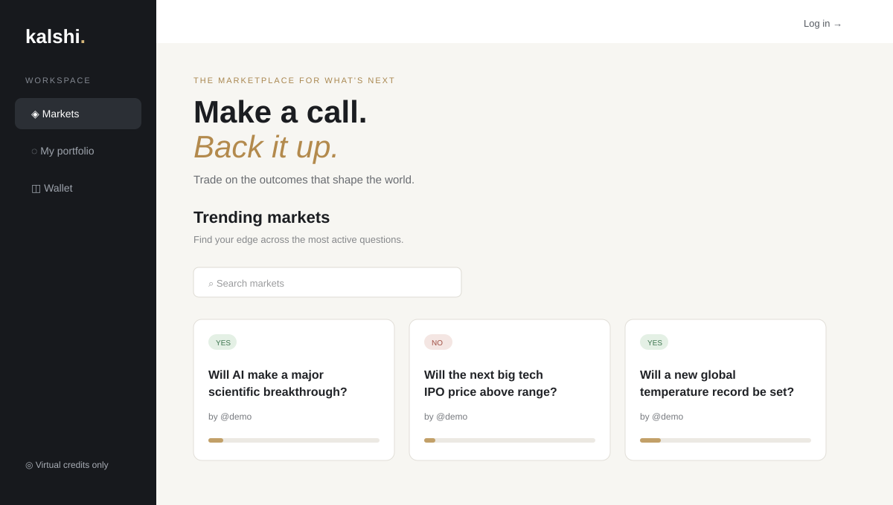
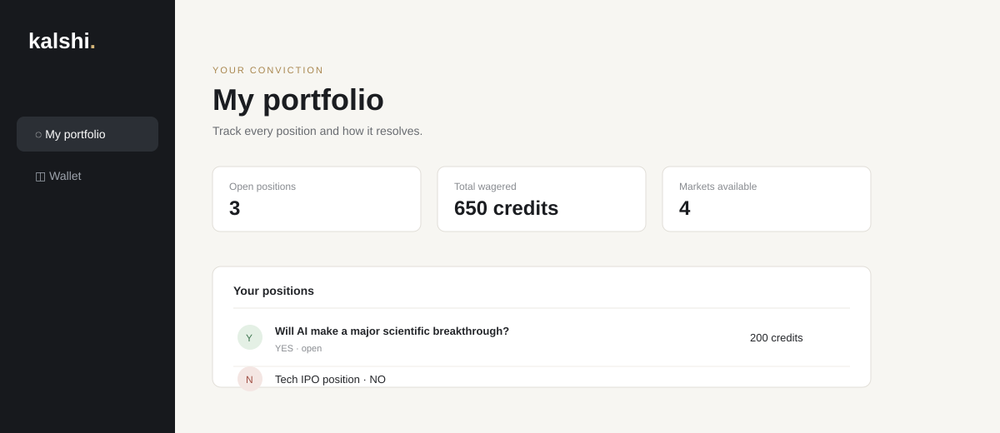

# Kalshi

Kalshi is a small prediction-market app for trading opinions with virtual credits. Users can create binary YES/NO markets, take the opposite side of an open market, follow their positions, and review their wallet history. Admins get a separate console for resolving expired markets and crediting user accounts.

> This project uses virtual credits only. It is a learning/demo application, not a real-money trading platform.

## Preview

The main experience is a focused market board with search, YES/NO filters, stake progress, and a lightweight dark mode.



The app also includes portfolio tracking, an atomic virtual wallet ledger, and an admin view for market resolution.



## Stack

- **Web:** Next.js 16, React 19, TypeScript
- **API:** Express 5, TypeScript, Zod validation
- **Data:** MongoDB with Mongoose
- **Auth:** JWT tokens and bcrypt password hashing
- **Workspace:** Bun workspaces and Turborepo
- **Shared code:** `@repo/ui`, shared ESLint and TypeScript configs

## Project structure

```text
apps/
  web/       Next.js client application
  api/       Express API and MongoDB models
  docs/      Secondary Next.js docs/demo app
packages/
  ui/        Shared React components
  eslint-config/
  typescript-config/
```

## Requirements

- Node.js 24+
- Bun 1.3.13+
- A running MongoDB instance

## Local setup

1. Install dependencies from the repository root:

   ```bash
   bun install
   ```

2. Create `apps/api/.env`:

   ```dotenv
   MONGODB_URI=mongodb://127.0.0.1:27017/kalshi
   JWT_SECRET=replace-this-with-a-long-random-secret-at-least-32-characters
   PORT=5000
   CLIENT_URL=http://localhost:3001
   ```

3. Point the web app at the API by creating `apps/web/.env.local`:

   ```dotenv
   NEXT_PUBLIC_API_URL=http://localhost:5000/api/v1
   ```

4. Start the API and web app in separate terminals:

   ```bash
   bun --cwd apps/api index.ts
   bun run dev --filter web
   ```

5. Open [http://localhost:3001](http://localhost:3001).

In development, the API seeds an admin account and demo markets on first startup:

| Account | Username | Password |
| --- | --- | --- |
| Demo user | `demo` | `demo-password` |
| Admin | `admin` | `admin-password` |

Change these credentials before using the project outside local development.

## Useful commands

Run these from the repository root:

```bash
bun run dev          # start all development tasks
bun run build        # build all apps and packages
bun run lint         # lint the workspace
bun run check-types  # run TypeScript checks
bun run format       # format TypeScript and Markdown files
```

To run only the web app or API, use the commands in the setup section. The API health check is available at [http://localhost:5000/api/v1/health](http://localhost:5000/api/v1/health) and returns `{ "status": "ok" }` when the server is ready.

## Core flows

- Sign up or sign in with a username and password.
- Create a market with a question, expiry, side, and opening wager.
- Bet the opposite side of another user's open market.
- Review open positions and wallet transactions.
- Add virtual credits through the wallet screen.
- Resolve expired markets as the creator or an admin.

## Notes

The repository still contains `apps/docs` as a secondary Next.js app from the original workspace scaffold. The primary product is `apps/web`, backed by `apps/api`.

## License

No license has been specified yet.
